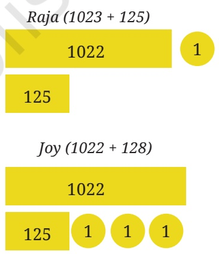
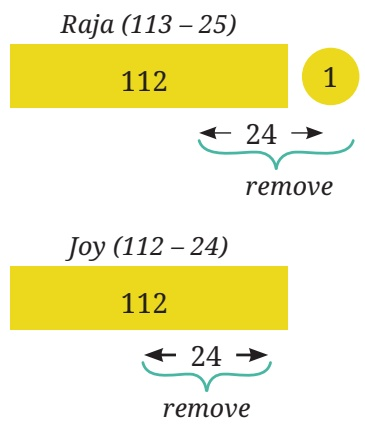

because the value of 10 + 2 = 12 is greater than the value of 7 + 1 =  8. Similarly,

$$
1 3 - 2 \leq 4 \times 3 .
$$

## Figure it Out

1. Fill in the blanks to make the expressions equal on both sides of the = sign: (a) 13 + 4 = \_\_\_\_ + 6 (b) 22 + \_\_\_\_ = 6 × 5 (c) 8 × \_\_\_\_ = 64 ÷ 2 (d) 34 – \_\_\_\_ = 25

2. Arrange the following expressions in ascending (increasing) order of their values. (a) $6 7 - 1 9$ (b) $6 7 - 2 0$ (c) (e) $3 5   \pm   2 5$ $1 2 0 \div 3$ (d) $5 \times 1 1$

## ? Example 2: Which is greater? 1023 + 125 or 1022 + 128?

Imagining a situation could help us answer this without finding the values. Raja had 1023 marbles and got 125 more today. Now he has 1023 + 125 marbles. Joy had 1022 marbles and got 128 more today. Now he has 1022 + 128 marbles. Who has more?

This situation can be represented as shown in the picture on the right. To begin with, Raja had 1 more marble than Joy. But Joy got 3 more marbles than Raja today. We can see that Joy has (two) more marbles than Raja now. That is,

$$
1 0 2 3 + 1 2 5 < 1 0 2 2 + 1 2 8 .
$$

## Example 3: Which is greater? 113 – 25 or 112 – 24?

Imagine a situation, Raja had 113 marbles and lost 25 of them. He has 113 – 25 marbles. Joy had 112 marbles and lost 24 today. He has 112 – 24 marbles. Who has more marbles left with them?

Raja had 1 marble more than Joy. But he also lost 1 marble more than Joy did. Therefore, they have an equal number of marbles now. That is,

$$
113-25=112-24.
$$

