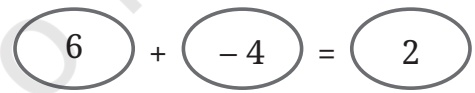
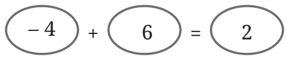

| Expression | Expression as the sum of its terms | Terms |
| --- | --- | --- |
| 13 - 2 + 6 | 13 + - 2 + 6 | 13, - 2, 6 |
| 5 + 6 × 3 | 5 + 6 × 3 |  |
| 4 + 15 - 9 | + + |  |
| 23 - 2 × 4 + 16 | + + |  |
| 28 + 19 - 8 | + + |  |

operations to find the value of an expression.

We will start with expressions having only additions (with all the subtractions suitably converted into additions).

？ Does changing the order in which the terms are added give different values?

## Swapping and Grouping

Let us consider a simple expression having only two terms.

**Example 6:** Madhu is flying a drone from a terrace. The drone goes 6 m up and then 4 m down. Write an expression to show how high the final position of the drone is from the terrace.

The drone is 6 – 4 = 2 m above the terrace. Writing it as sum of terms:

Will the sum change if we swap the terms?

It doesn’t in this case.

We already know that swapping the terms does not change the sum when both the terms are positive numbers.

? Will this also hold when there are terms having negative numbers as well? Take some more expressions and check.