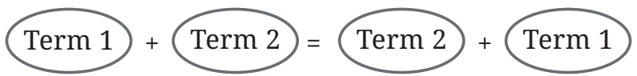
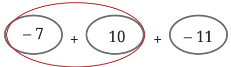
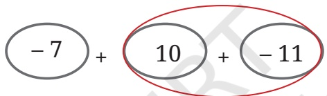

? Can you explain why this is happening using the Token Model of integers that we saw in the Class 6 textbook of mathematics?

Thus, in an expression having two terms, swapping them does not change the value.

Now consider an expression having three terms: (–7) + 10 + (–11). Let us add these terms in the following two different orders:

(adding the first two terms and then adding their sum to the third term)

(adding the last two terms and then adding their sum to the first term)

What do you see? The sums are the same in both cases.

Again, we know that while adding positive numbers, grouping them in any of the above two ways gives the same sum.

？ Will this also hold when there are terms having negative numbers as well? Take some more expressions and check.

？ Can you explain why this is happening using the Token Model of integers that we saw in the Class 6 textbook of mathematics?

**Thus, grouping the terms of an expression in either of the following ways gives the same value.**

Let us consider the expression (–7) + 10 + (–11) again. What happens when we change the order and add –7 and –11 first, and then add this sum to 10? Will we get the same sum as before?

We see that adding the terms of the expression (–7) + 10 + (–11) in any order gives the same sum of –8.