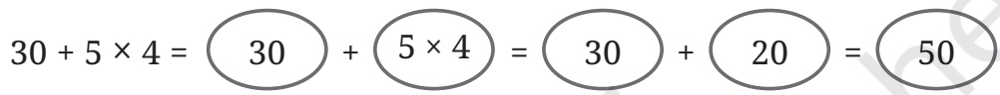
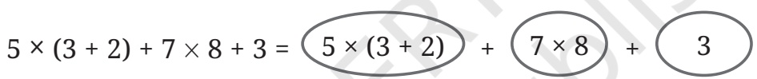
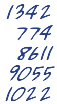
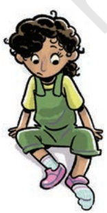
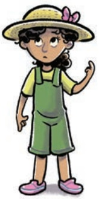
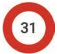

？ Does adding the terms of an expression in any order give the same value? Take some more expressions and check. Consider expressions with more than 3 terms also.

Can you explain why this is happening using the Token Model of integers that we saw in the Class 6 textbook of mathematics?

**Thus, the addition of terms in any order gives the same value.** Therefore, in an expression having only additions, it does not matter in what order the terms are added: they all give the same value.

Now let us consider expressions having multiplication and division also, without the order of operations specified by the brackets. The values of such expressions are found by first evaluating the terms. Once all the terms are evaluated, they are added.

For example, the expression $3 0 \pm 5 \times 4$ is evaluated as follows:

The expression $5 \times (3 + 2) + 7 \times 8 + 3$ is evaluated as follows:

Where (3+2) is first evaluated and this sum is multiplied by 5 (= 25). The expression 7 × 8 is evaluated (= 56). This simplifies to $25+56+3=$ 84.

? Manasa is adding a long list of numbers. It took her five minutes to add them all and she got the answer 11749. Then she realised that she had forgotten to include the fourth number 9055. Does she have to start all over again?

In mathematics we use the phrase **commutative property** 1022 of **addition** instead of saying “swapping terms does not change the sum”. Similarly, “grouping does not change the sum” is called the **associative property of addition**.

## Swapping the Order of Things in Everyday Life

? Manasa is going outside to play. Her mother says, “Wear your hat and shoes!” Which one should she wear first? She can wear her hat first and then her shoes. Or she can wear her shoes first and then her hat.

Manasa will look exactly the same in both cases. Imagine a different situation: Manasa’s mother says “Wear your socks and shoes!” Now the

