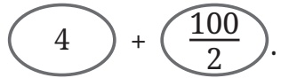

For each of the cases below, write the expression and identify its terms: If the teacher had called out ‘4’, Ruby would write If the teacher had called out ‘7’, Ruby would write Write expressions like the above for your class size.

## ? Example 9: Raghu bought 100 kg of rice from the wholesale market and packed them into 2 kg packets. He already had four 2 kg packets. Write an expression for the number of 2 kg packets of rice he has now and identify the terms.

He had 4 packets. The number of new 2 kg packets of rice is $1 0 0 \div 2 ,$ which we also write as $\frac { 1 0 0 } { 2 }$

The number of 2 kg packets he has now is $4 + { \frac { 1 0 0 } { 2 } } ,$

？ **Example 10:** Kannan has to pay ₹432 to a shopkeeper using coins of ₹1 and ₹5, and notes of ₹10, ₹20, ₹50 and ₹100. How can he do it?

There is more than one possibility. For example,

$$
432=4\times100+1\times20+1\times10+2\times1
$$

Meaning: 4 notes of ₹100, 1 note of ₹20, 1 note of ₹10 and 2 notes of ₹1 432 = 8 × 50 + 1 × 10 + 4 × 5 + 2 × 1

Meaning: 8 notes of ₹50, 1 note of ₹10, 4 notes of ₹5 and 2 notes of ₹1

Identify the terms in the two expressions above.

? Can you think of some more ways of giving ₹432 to someone?

？ **Example 11:** Here are two pictures. Which of these two arrangements matches with the expression $5 \times 2 + 3 ?$