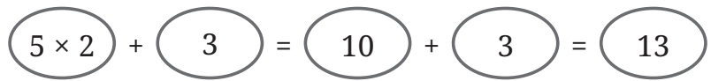

Let us write this expression as a sum of terms.

This expression $5   \times   2   +   3$ can be understood as 3 more than $5 \times 2 ,$ which describes the arrangement on the left.

？ What is the expression for the arrangement in the right making use of the number of yellow and blue squares?

Do you recall the use of brackets? We need to use brackets for this.

$$
2 \times ( 5 + 3 )
$$

Notice that this arrangement can also be described using—

$$
\begin{aligned} &5 + 3 + 5 + 3\\ &\quad  OR  \\&5 \times 2 + 3 \times 2\\ \end{aligned}
$$

## Figure it Out

1. Find the values of the following expressions by writing the terms in each case. (a) $2 8 - 7 + 8$ (b) $39 - 2 \times 6 + 11$ (c) $4 0 - 1 0 + 1 0 + 1 0$ (d) $48-10\times2+16\div2$ (e) $6 \times 3 - 4 \times 8 \times 5$

2. Write a story/situation for each of the following expressions and find their values. (a) $89 + 21 = 10$ (b) $5 \times 1 2 - 6$ (c) $4 \times 9 + 2 \times 6$

3. For each of the following situations, write the expression describing the situation, identify its terms and find the value of the expression.

(a) Queen Alia gave 100 gold coins to Princess Elsa and 100 gold coins to Princess Anna last year. Princess Elsa used the coins to start a business and doubled her coins. Princess Anna bought jewellery and has only half of the coins left. Write an expression describing how many gold coins Princess Elsa and Princess Anna together have.

(b) A metro train ticket between two stations is ₹40 for an adult and ₹20 for a child. What is the total cost of tickets:

(i) for four adults and three children?

(ii) for two groups having three adults each?