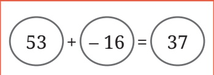
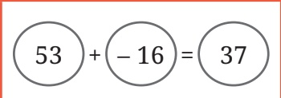
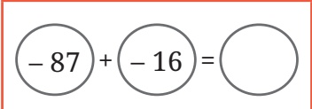
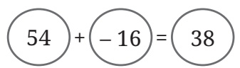
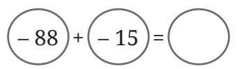
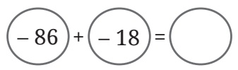
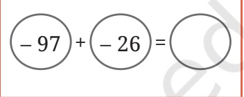

？

54 is one more than 53, so the value will be 1 more than 37.

52 is one less than 53, so the value will be 1 less than 37.

Is –15 one more or one less than –16?

Is –17 one more or one less than –16?

## Figure it Out

1. Fill in the blanks with numbers, and boxes with operation signs such that the expressions on both sides are equal.

(a) $24+(6-4)=24+6$

(b) $38+(\boxed{\quad}\boxed{\quad}\boxed{\quad}=38+9-4$

(c) $24-(6+4)=24$

(d) 24 – 6 – 4 = 24 – 6

(e) $27-(8+3)=27\ 8\ 3$

(f) $27-(27-8+3)=27-8+3$

2. Remove the brackets and write the expression having the same value.

(a) $1 4 \pm ( 1 2 \pm 1 0 )$

(b) $1 4 - ( 1 2 \pm 1 0 )$

(c) $1 4 \pm ( 1 2 - 1 0 )$

(d) $1 4 - ( 1 2 - 1 0 )$

(e) $-14+(12-10)$

(f) $1 4 - ( - 1 2 - 1 0 )$

3. 	Find the values of the following expressions. For each pair, first try to guess whether they have the same value. When are the two expressions equal?

(a) (6 + 10) – 2 and 6 + (10 – 2)

(b) 16 – (8 – 3) and (16 – 8) – 3

(c) 27 – (18 + 4) and 27 + (–18 – 4)

4. In each of the sets of expressions below, identify those that have the same value. Do not evaluate them, but rather use your understanding of terms.