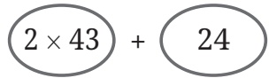
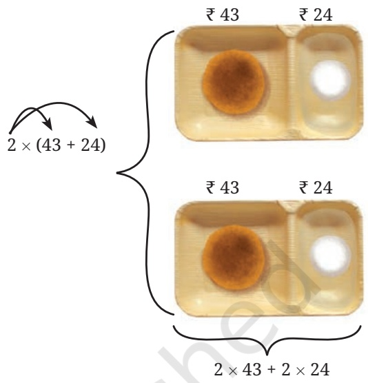
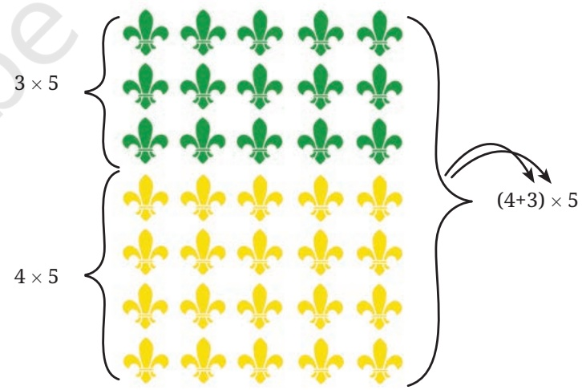
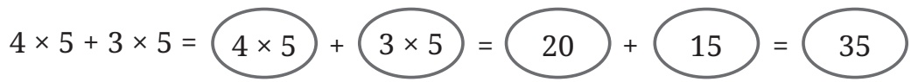

Writing it as sum of terms gives:

This expression means 24 more than $2 \times 4 3$ . But, we want an expression which means twice or double of $4 3 \pm 2 4$

We can make use of brackets to write such an expression:

$$
2 \times ( 4 3 \pm 2 4 ) .
$$

So, we can say that together they have to pay $2 \times ( 4 3 \pm 2 4 )$ . This is also the same as paying for two vegetable cutlets and two rasgullas:

$$
2 \times 4 3 + 2 \times 2 4 .
$$

Therefore,

$$
2 \times (43 + 24) = 2 \times 43 + 2 \times 24.
$$

? If another friend, Sangmu, joins them and orders the same items, what will be the expression for the total amount to be paid?

? **Example 16:** In the Republic Day parade, there are boy scouts and girl guides marching together. The scouts march in 4 rows with 5 scouts in each row. The guides march in 3 rows with 5 guides in each row (see the figure below). How many scouts and guides are marching in this parade?

The number of boy scouts marching is $4 \times 5$ . The number of girl guides marching is $3 \times 5$

The total number of scouts and guides will be $4 \times 5 + 3 \times 5$

This can also be found by first finding the total number of rows, i.e., 4 + 3, and then multiplying their sum by the number of children in each row. Thus, the number of boys and girls can be found by $(4 + 3) \times 5$

Therefore, $4 \times 5 + 3 \times 5$

$$
= ( 4 + 3 ) \times 5 .
$$

Computing these expressions, we get

