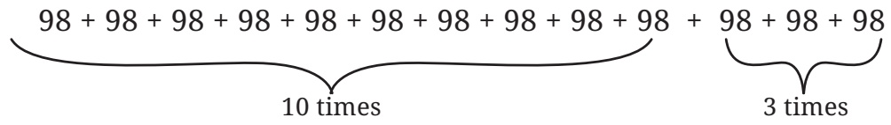
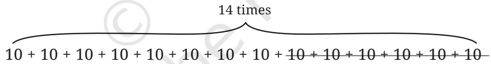

$$
(4 + 3) \times 5 = 7 \times 5 = 35
$$

5 × 4 + 3 ≠ 5 × (4 + 3). Can you explain why?

$$
\mathrm{I} \mathrm{s} 5 \times (4+3)=5 \times (3+4)=(3+4) \times 5?
$$

The observations that we have made in the previous two examples can be seen in a general way as follows.

Consider $10 \times 98 + 3 \times 98$ . This means taking the sum of 10 times 98 and 3 times 98.

Clearly, this is the same as $10+3=13$ times 98. Thus,

$$
10 \times 98 + 3 \times 98 = (10 + 3) \times 98.
$$

Writing this equality the other way, we get

$$
(10 + 3)\;98 = 10 \times 98 \pm 3 \times 98.
$$

Swapping the numbers in the products above, this property can be seen in the following form:

$$
98 \times 10 + 9 \times 83 = 98(10 + 3)
$$

$$
98\left (10 \div 3\right ) = 98 \times 10 + 98 \times 3.
$$

Similarly, let us consider the expression $14 \times 10 - 6 \times 10$ . This means subtracting 6 times 10 from 14 times 10.

14 times

Clearly, this is 14 – 6 = 8 times 10. Thus,

$$
\begin{aligned}\underbrace{14 \times 10 - 6 \times 10}_{ \text{000000000}} &= (14 - 6) \times 10, \\  or  \end{aligned}
$$

$$
(14 - 6) \times 10 = 14 \times 10 - 6 \times 10
$$

This property can be nicely summed up as follows:

**The multiple of a sum (difference) is the same as the sum (difference) of the multiples.**

## Tinker the Terms II

Let us understand what happens when we change the numbers occurring in a product.