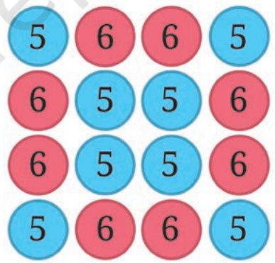

(m) 5 × (12 –\_\_\_\_) = 5 ×

(n) $(15 - \underline{\quad} ) \times 7 = \underline{\quad} \boxed{\quad} 6 \times 7$

(o) $5 \times ( \underline{\hspace{1cm}} - \underline{\hspace{1cm}} ) = 5 \times 9 - 5 \times 4$

(p) $\left( \underline{\quad} - \underline{\quad} \right) \times \underline{\quad} = 17 \times 7 - 9 \times 7$

2. In the boxes below, fill ‘<’, ‘>’ or ‘=’ after analysing the expressions on the LHS and RHS. Use reasoning and understanding of terms and brackets to figure this out and not by evaluating the expressions.

(a) $( 8 - 3 ) \times 2 9$

(3 – 8) × 29

(b) $1 5 \pm 9 \times 1 8$

(15 + 9) × 18

(c) 23 × (17 – 9)

23 × 17 + 23 × 9

(d) (34 – 28) × 42 34 × 42 – 28 × 42

3. Here is one way to make 14: $\underline { { \underline { { 2 } } } } \times ( \underline { { \underline { { 1 } } } } + \underline { { \underline { { 6 } } } } ) = 1 4$ . Are there other ways of getting 14? Fill them out below:

(a) \_× ( + \_) = 14

(b) × ( + \_) = 14

(c) \_\_\_ \_× (\_ \_+\_\_\_\_\_) = 14

(d) \_\_\_\_\_× (\_ \_+\_\_\_\_ \_) = 14

4. Find out the sum of the numbers given in each picture below in at least two different ways. Describe how you solved it through expressions.

## Figure it Out

1. Read the situations given below. Write appropriate expressions for each of them and find their values.

(a) The district market in Begur operates on all seven days of a week. Rahim supplies 9 kg of mangoes each day from his orchard and Shyam supplies 11 kg of mangoes each day from his orchard to this market. Find the amount of mangoes supplied by them in a week to the local district market.