?

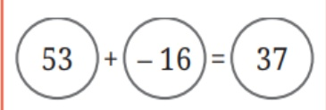

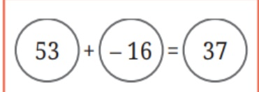

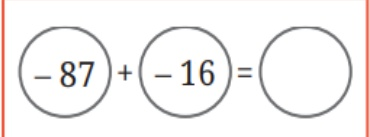

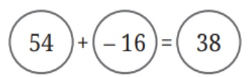

54 is one more than 53, so the value will be 1 more than 37.

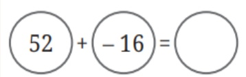

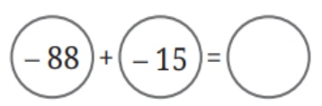

52 is one less than 53, so the value will be 1 less than 37.

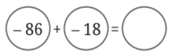

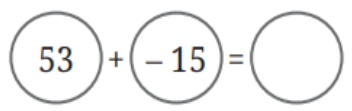

Is –15 one more or one less than –16?

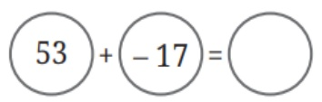

Is –17 one more or one less than –16?

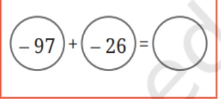

## Ans:

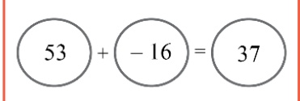

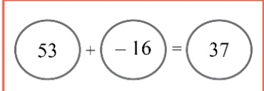

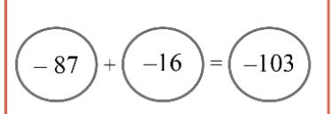

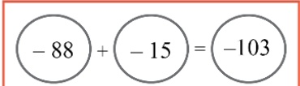

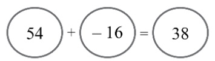

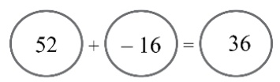

88 is one less than – 87 and 15 is one more than – 16, so the value will be the same.

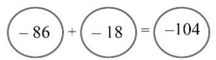

- 86 is one more than - 87 and – 18 is two less than – 16, so the value will be one les than – 103.

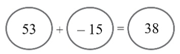

Yes, – 15 is one more than – 16?

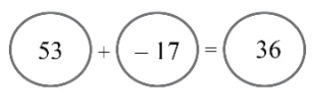

Yes, – 17 is one less than -16

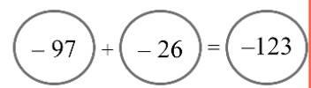

– 97 is ten less than – 87 and - 26 is ten less than - 16, so the value will be 20 less than – 103.