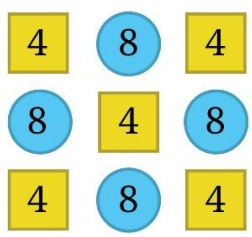
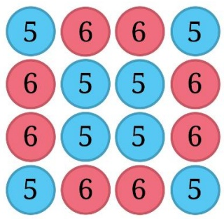

2. In the boxes below, fill in ‘<', >' or ‘=' after analysing the expressions on the LHS and RHS. Use reasoning and understanding of terms and brackets to figure this out, and not by evaluating the expressions.

(a) (8– 3) × 29

(3-8)×29

(b) 15 + 9 × 18

(15 + 9) × 18

(c) 23 × (17 – 9)

23×17+23×9

(d) (34- 28) ×42

34×42-28×42

Ans:

(a) >: since 8 - 3 > 3 - 8

(b) <

(c) <

(d) =

[Try to reason in other parts]

3. Here is one way to make 14: 2 × (1 + 6) = 14. Are there other ways of getting 14? Fill them out below:

(a) ×( 十 ) = 14

(b) ×( + ) = 14

(c) ×( + ) = 14

(d) ×( + ) = 14

Ans:

(a)

$$
\underline { { 2 } } \times ( \underline { { 5 } } + \underline { { 2 } } ) = 1 4
$$

(b)

$$
\underline{2} \times (\underline{3} + \underline{4}) = 14
$$

(c)

$$
\underline { { 7 } } \times ( \underline { { 1 } } + \underline { { 1 } } ) = 1 4
$$

(d)

$$
\underline{2} \times (\underline{6} + \underline{1}) = 14
$$

4. Find out the sum of the numbers given in each picture below in at least two different ways. Describe how you solved it through expressions.

(I)

(II)