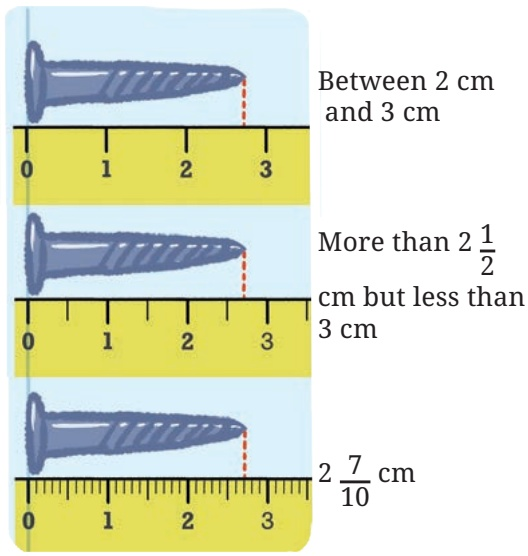
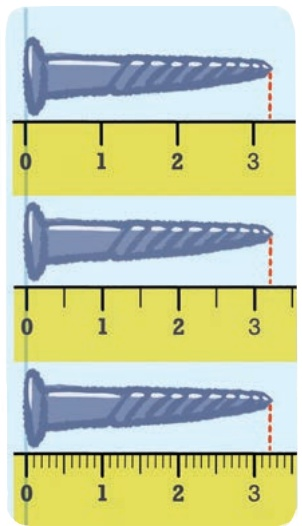

？ Which scale helped you measure the length of the screws accurately? Why?

What is the meaning of $2 \frac { 7 } { 1 0 }$ cm (the length of the first screw)?

As seen on the ruler, the unit length between two consecutive numbers is divided into 10 equal parts. To get the length $2   \frac { 7 } { 1 0 }   \mathrm { c m }$ , we go from 0 to 2 and then take seven parts of $\frac{1}{10}.$ The length of the screw is 2 cm and $\frac { 7 } { 1 0 }$ cm. Similarly, we can make sense of the length $3   \frac { 2 } { 1 0 }   \mathrm { c m }$ We read $2 \frac { 7 } { 1 0 }$ cm as **two and seven-tenth centimeters**, and $3 \frac { 2 } { 1 0 }$ cm as **three and two-tenth centimeters**.

？ Can you explain why the unit was divided into smaller parts to measure the screws?

？ Measure the following objects using a scale and write their measurements in centimeters (as shown earlier for the lengths of the screws): pen, sharpener, and any other object of your choice.

？ Write the measurements of the objects shown in the picture: