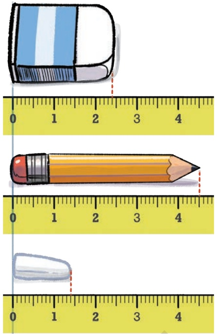
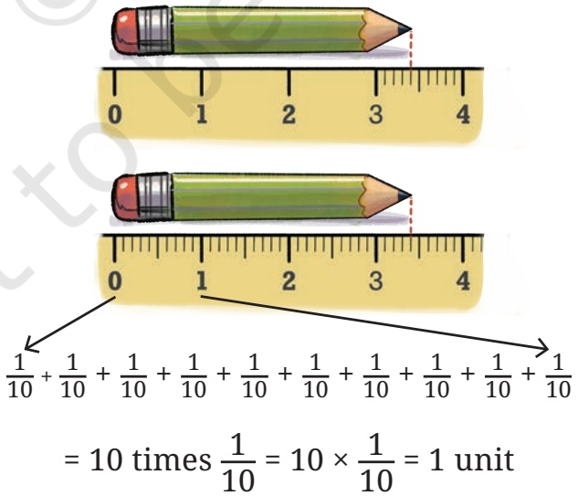

As seen here, when exact measures are required we can make use of smaller units of measurement.

## 3.2 A Tenth Part

The length of the pencil shown in the figure below is $^ 3 \frac { 4 } { 1 0 }$ units, which can also be read as 3 units and four one-tenths, i.e., $( 3 \times 1 ) + \left( 4 \times { \cfrac { 1 } { 1 0 } } \right)$ units.

This length is the same as 34 one-tenths units because 10 one-tenths units make one unit.