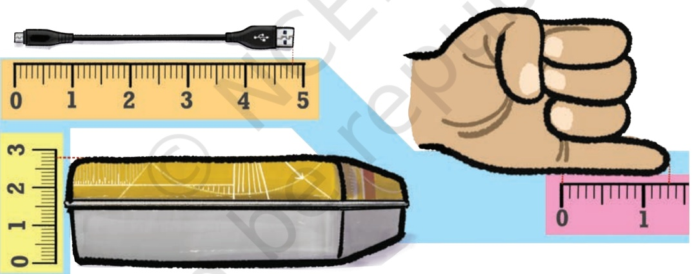
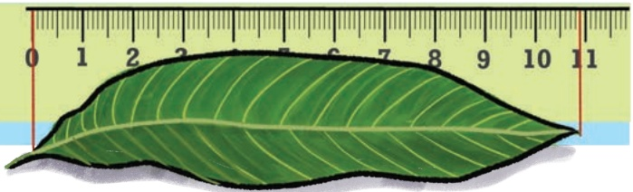

$$
34 \times \frac{1}{10} = \frac{34}{10} = \frac{10}{10} + \frac{10}{10} + \frac{10}{10} + \frac{4}{10}
$$

$$
1 + 1 + 1 + \frac{4}{10}   (3 and   4   one-teths)
$$

A few numbers with fractional units are shown below along with how to read them.

$4   { \frac { 1 } { 1 0 } } { \longrightarrow }$ **‘four and one-tenth’**

$\frac { 4 } { 1 0 }$ **‘four one-tenths’** or **‘four-tenths’**

$\frac { 4 1 } { 1 0 }$ **‘forty-one one-tenths’** or **‘forty-one tenths’**

41 $\frac { 1 } { 1 0 }$ **‘forty-one and one-tenth’**

For the objects shown below, write their lengths in two ways and read them aloud. An example is given for the USB cable. (Note that the unit length used in each diagram is not the same).

The length of the USB cable is 4 and $\frac{8}{10}$ units or $\frac{48}{10}$ units.

è Arrange these lengths in increasing order:

(a) $\frac { 9 } { 1 0 }$

(b) $^ 1 \frac { 7 } { 1 0 }$

(c) $\frac { 1 3 0 } { 1 0 }$

(d) $^ { 1 3 } \frac { 1 } { 1 0 }$

(e) $1 0   \frac { 5 } { 1 0 }$

(f) $7 \frac { 6 } { 1 0 }$

(g) $6 \frac { 7 } { 1 0 }$

(h) $\frac { 4 } { 1 0 }$