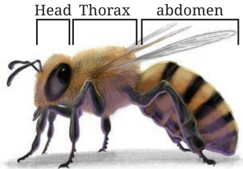
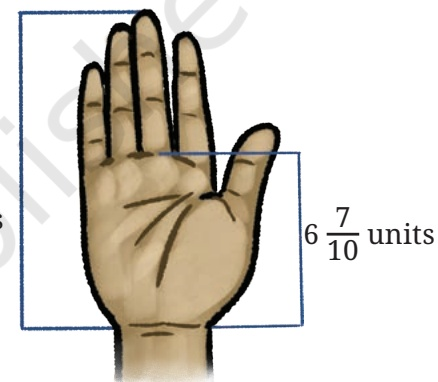

equal to 6 units and 3 one-tenths, i.e., $6   { \frac { 3 } { 1 0 } } .$

？ The lengths of the body parts of a honeybee are given. Find its total length.

Head: $2   \frac { 3 } { 1 0 }$ units

Thorax: $5 { \frac { 4 } { 1 0 } }$ units

Abdomen: $7 \frac { 5 } { 1 0 }$ units

Head <u>Thorax</u> abdomen

The length of Shylaja’s hand is $1 2   \frac { 4 } { 1 0 }$ units,

and her palm is $6 { \frac { 7 } { 1 0 } }$ units, as shown in the picture. What is the length

of the longest (middle) finger?

The length of the finger can be found by evaluating $\left( 1 2 + { \cfrac { 4 } { 1 0 } } \right) - \left( 6 + { \cfrac { 7 } { 1 0 } } \right)$ . This can be done in different ways. For example,

12 10 4 units

7 6 10 units

$$
\begin{aligned} (a)  \quad & 12 + \frac{4}{10} - 6 - \frac{7}{10} \\& = (12 - 6) + \left( \frac{4}{10} - \frac{7}{10} \right) \\& = 6 - \frac{3}{10} \\& = 5 + 1 - \frac{3}{10} \\& = 5 + \frac{10}{10} - \frac{3}{10} \\& = 5 + \frac{7}{10} = 5 \frac{7}{10}\end{aligned}
$$

Discuss what is being done here and why.

$$
\begin{array}{ccc}( b ) & 12\dfrac{4}{10} &  \\\underbrace{-6\dfrac{7}{10}} & \longrightarrow & 11\dfrac{14}{10} \\&  & -6\dfrac{7}{10} \\&  & =5\dfrac{7}{10} \\\end{array}
$$

As in the case of counting numbers, it is convenient to start subtraction from the tenths. We cannot remove 7 one-tenths from 4