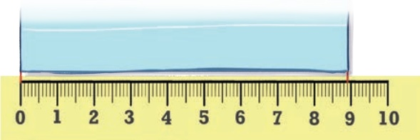

one-tenths. So we split a unit from 12 and convert it to 10 one-tenths. Now, the number has 11 units and 14 one-tenths. We subtract 7 onetenths from 14 one-tenths and then subtract 6 units from 11 units.

？ Try computing the difference by converting both lengths to tenths.

？ A Celestial Pearl Danio's length is $2 { \frac { 4 } { 1 0 } } { \mathrm { c m } }$ , and the length of a Philippine Goby is $\frac { 9 } { 1 0 }$ cm. What is the difference in their lengths?

How big are these fish compared to your finger?

Celestial Pearl Danio

Philippine Goby

？ Observe the given sequences of numbers. Identify the change after each term and extend the pattern:

(a) $4 , 4   \frac { 3 } { 1 0 } , 4   \frac { 6 } { 1 0 }$

(b) $8 \frac{2}{10}, 8 \frac{7}{10}, 9 \frac{2}{10}$

(c) $7 \frac{6}{10}, 8 \frac{7}{10};$

(d) $5   \frac { 7 } { 1 0 }   ,   5   \frac { 3 } { 1 0 }   ;$

(e) $1 3   \frac { 5 } { 1 0 }   ,   1 3 ,   1 2   \frac { 5 } { 1 0 }$

(f) $11\frac{5}{10},10\frac{4}{10},9\frac{3}{10}$

## 3.3 A Hundredth Part

The length of a sheet of paper was 8 $\frac { 9 } { 1 0 }$ units, which can also be said as 8 units and 9 one-tenths. It is folded in half along its length. What is its length now?

