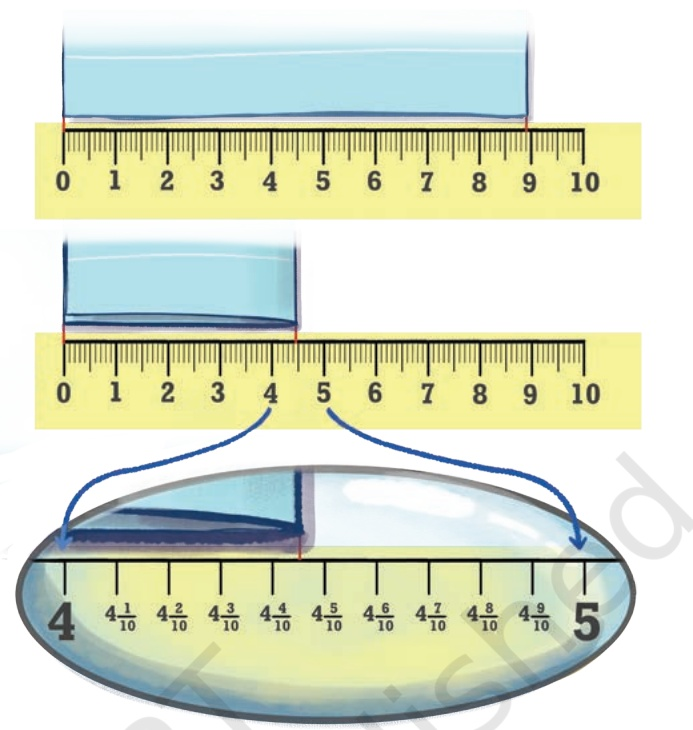
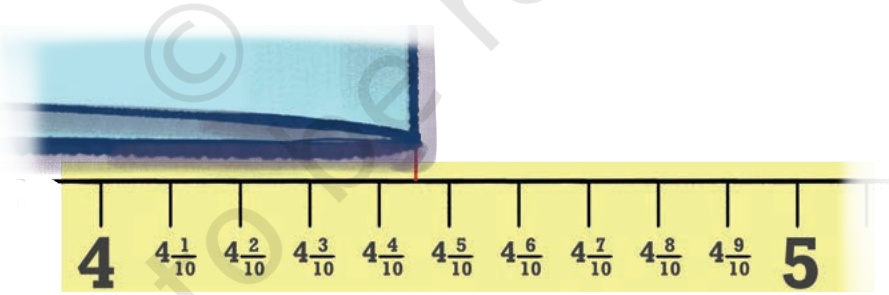

We can say that its length is between $^ { 4 } \mathrm { ~ \frac { ~ 4 ~ } { ~ 1 0 ~ } ~ }$ units and $4 ~ { \frac { 5 } { 1 0 } }$ units. But we cannot state its exact measurement, since there are no markings. Earlier, we split a unit into 10 one-tenths to measure smaller lengths. We can do something similar and split each one-tenth into 10 parts.

## What is the length of this smaller part? How many such smaller parts make a unit length?

As shown in the figure below, each one-tenth has

10 smaller parts, and there are 10 one-tenths in a unit; therefore, there will be 100 smaller parts in a unit. Therefore, one part’s length will be $\frac { 1 } { 1 0 0 }$ of a unit.

Returning to our question, what is the length of the folded paper? We can see that it ends at $4   { \frac { 4 } { 1 0 } } { \frac { 5 } { 1 0 0 } } ,$ read as 4 units and 4 one-tenths and 5 one-hundredths.

How many one-hundredths make one-tenth? Can we also say that the length is 4 units and 45 one-hundredths?