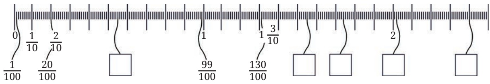
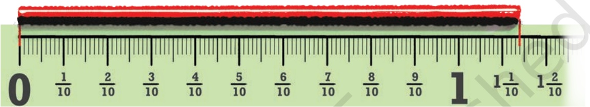
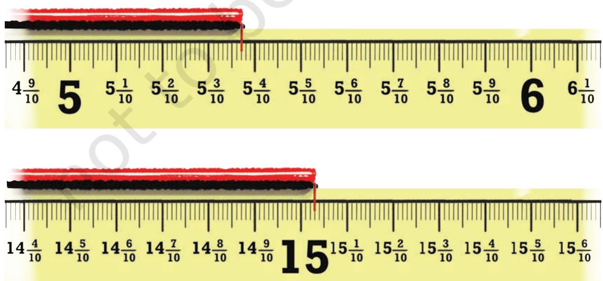

Observe the figure below. Notice the markings and the corresponding lengths written in the boxes when measured from 0. Fill the lengths in the empty boxes.

The length of the wire in the first picture is given in three different ways. Can you see how they denote the same length?

$1   { \frac { 1 } { 1 0 } } { \frac { 4 } { 1 0 0 } }$ One and one-tenth and four-hundredths 1 14 One and fourteen-hundredths 100 114 One Hundred and Fourteen-hundredths 100

？ For the lengths shown below write the measurements and read out the measures in words.

