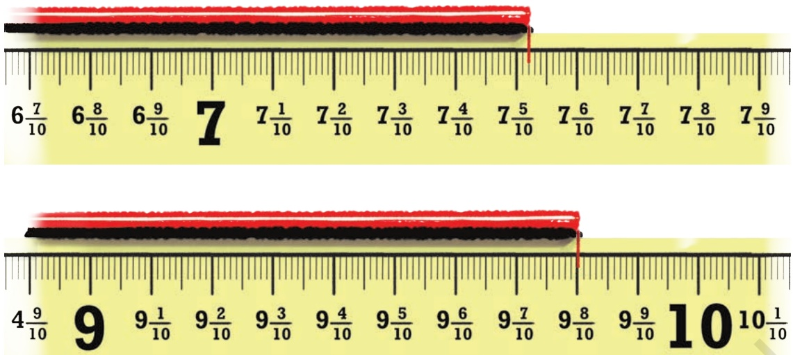

In each group, identify the longest and the shortest lengths. Mark each length on the scale.

(a) $\frac{3}{10}, \frac{3}{100}, \frac{33}{100}$

$$
(b) \quad 3\frac{1}{10}, \frac{30}{10}, \frac{3}{10}
$$

$$
\frac{45}{100}, \frac{54}{100}, \frac{5}{10}, \frac{4}{10}
$$

$$
\stackrel { \rightharpoonup } { 3 } \frac { 6 } { 1 0 }   ,   3   \frac { 6 } { 1 0 0 }   ,   3   \frac { 6 } { 1 0 } \frac { 6 } { 1 0 0 }
$$