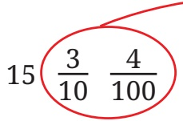
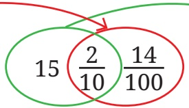

What is the difference 15 $\frac { 3 } { 1 0 } \frac { 4 } { 1 0 0 }   -   2   \frac { 6 } { 1 0 } \frac { 8 } { 1 0 0 }   ?$

One way to solve this is as follows:

$$
-   2   \frac { 6 } { 1 0 }   \mathrm { ~ \frac { 8 } { 1 0 0 } ~ }
$$

$$
-   2 \quad { \frac { 6 } { 1 0 } } \quad { \frac { 8 } { 1 0 0 } }
$$

12 14 14 10 100

$$
\frac{1 - 2\ \frac{6}{10}\ \frac{8}{100}}{1 - 12\ \frac{6}{10}\ \frac{6}{100}}
$$

Observe the subtraction done below for $6 5 3 - 2 6 8$ . Do you see any similarities with the methods shown above?

Math Talk

$$
\begin{array}{l}\left( 600+50+3 \right) - \left( 200+60+8 \right) \\= \left( 600-200 \right) + \left( 50-60 \right) + \left( 3-8 \right) \\= \left( 600-200 \right) + \left( 40-60 \right) + \left( 13-8 \right) \\= \left( 600-200 \right) + \left( 40-60 \right) + 5 \\= \left( 500-200 \right) + \left( 140-60 \right) + 5 \\= 300+80+5 \\= 385\end{array}
$$

**Figure it Out**

Find the sums and differences:

(a) $\frac { 3 } { 1 0 }   +   3   \frac { 4 } { 1 0 0 }$

(b) $9   \frac { 5 } { 1 0 } \frac { 7 } { 1 0 0 } + 2   \frac { 1 } { 1 0 } \frac { 3 } { 1 0 0 }$

(c) $15\frac{6}{10}\frac{4}{100}+14\frac{3}{10}\frac{6}{100}$

(d) $7   \frac { 7 } { 1 0 0 }   -   4   \frac { 4 } { 1 0 0 }$

(e) $8\frac{6}{100} = 5\frac{3}{100}$

(f) $1 2   { \frac { 6 } { 1 0 0 } }   { \frac { 2 } { 1 0 0 } }   -   { \frac { 9 } { 1 0 } }   { \frac { 9 } { 1 0 0 } }$

## 3.4 Decimal Place Value

You may have noticed that whenever we need to measure something more accurately, we split a part into 10 (smaller) equal parts ― we split a unit into 10 one-tenths and then split each one-tenth into 10, onehundredths and then we use these smaller parts to measure.