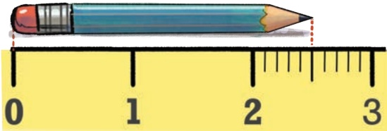
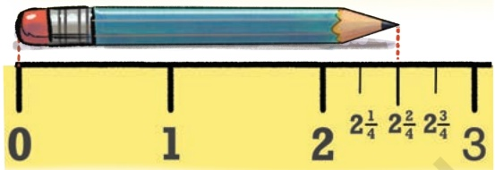
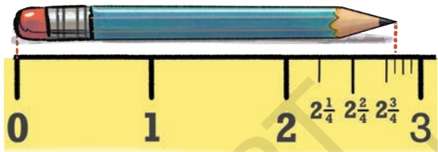
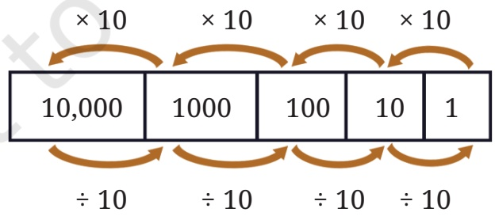

Can we not split a unit into 4 equal parts, 5 equal parts, 8 equal parts, or any other number of equal parts instead?

Yes, we can. The example below compares how the same length is represented when the unit is split into 10 equal parts and when the unit is split into 4 equal parts.

If an even more precise measure is needed, each quarter can further be split into four equal parts. Each part then measures $\frac { 1 } { 1 6 }$ of a unit, i.e., 16 such parts make 1 unit.

Then why split a unit into 10 parts every time?

The reason is the special role that 10 plays in the Indian place value system. For a whole number written in the Indian place value system — for example, 281 — the place value of 2 is hundreds (100), that of 8 is tens (10), and that of 1 is one (1). Each place value is 10 times bigger than the one immediately to its right. Equivalently, each place value is 10 times smaller than the one immediately to its left:

10 ones make 1 ten,

10 tens make 1 hundred,

10 hundreds make 1 thousand, and so on.

In order to extend this system of writing numbers to quantities smaller than one, we divide one into 10 equal parts. What does this give? It gives one-tenth. Further dividing it into 10 parts gives one-hundredth, and so on.