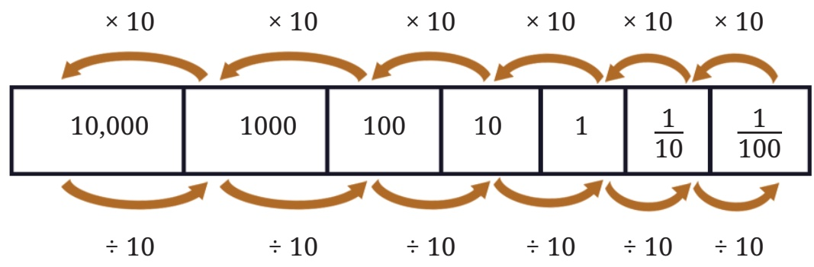
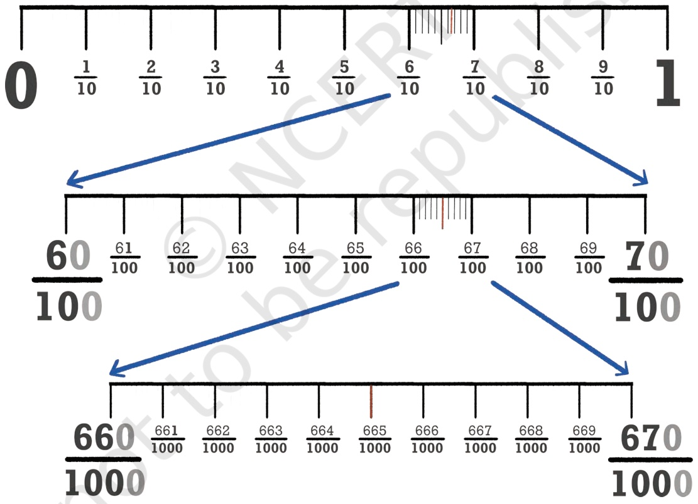

Can we extend this further?

What will the fraction be when $\frac { 1 } { 1 0 0 }$ is split into 10 equal parts? It will be $\frac { 1 } { 1 0 0 0 }$ , i.e., a thousand such parts make up a unit.

Just as when we extend to the left of 10,000, we get bigger place values at each step, we can also extend to the right of $\frac { 1 } { 1 0 0 0 }$ , getting smaller place values at each step.