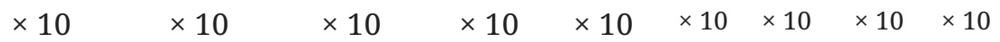
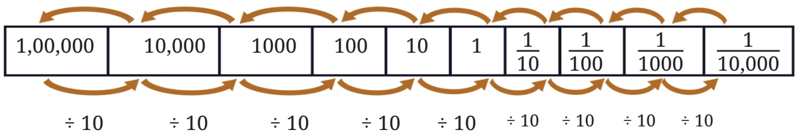
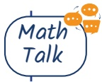

This way of writing numbers is called the “decimal system” since it is based on the number 10; “decem” means ten in Latin, which in turn is cognate to the Sanskrit daśha meaning 10, with similar words for 10 occurring across many Indian languages including Odia, Konkani, Marathi, Gujarati, Hindi, Kashmiri, Bodo, and Assamese. We shall learn about other ways of writing numbers in later grades.

## How Big?

We already know that a hundred 10s make 1000, and a hundred 100s make 10000.

? We can ask similar questions about fractional parts:

(a) How many thousandths make one unit?

(b) How many thousandths make one tenth?

(c) How many thousandths make one hundredth?

(d) How many tenths make one ten?

(e) How many hundredths make one ten?

Make a few more questions of this kind and answer them.

## Notation, Writing and Reading of Numbers

We have been writing numbers in a particular way, say 456, instead of writing them as $4 \times 100$ (4 hundreds) $+ 5 \times 1 0$ (5 tens) $+ 6 \times 1$ (6 ones). Similarly, can we skip writing tenths and hundredths?

Can the quantity $4   \frac { 2 } { 1 0 }$ be written as 42 (skipping the $\frac { 1 } { 1 0 }$ in $2 \times { \cfrac { 1 } { 1 0 } } \Big / ?$

If yes, how would we know if 42 means 4 tens and 2 units or it means 4 units and 2 tenths?

Similarly, 705 could mean:

(a) 7 hundreds, and 0 tens and 5 ones (700 + 0 + 5)

(b) 7 tens and 0 units and 5 tenths $\left( 7 0   +   0   +   { \frac { 5 } { 1 0 } } \right)$

(c) 7 units and 0 tenths and 5 hundredths $\left(7+\frac{0}{10}+\frac{5}{100}\right)$