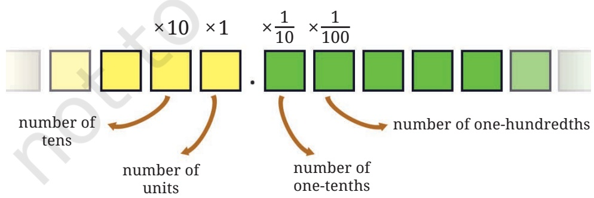

number of one-hundredths

Since these are different quantities, we need to have distinct ways of writing them.

To identify the place value where integers end and the fractional parts start, we use a point or period (‘.’) as a separator, called a **decimal point**.

The above quantities in decimal notation are then:

| Quantity | Decimal Notation |
| --- | --- |
| 7 hundreds and 5 ones(700 + 0 + 5) | 705 |
| 7 tens and 5 tenths (70 + 0 + 1 50) | 70.5 |
| 7 units and 5 hundredths(7 + 0 + 1 500) | 7.05 |

These numbers, when shown through place value, are as follows:

| Decimal number | Hundreds | Tens | Units | Tenths | Hundredths |
| --- | --- | --- | --- | --- | --- |
| 705 | 7 × 100 | 0 × 10 | 5 × 1 |  |  |
| 70.5 |  | 7 × 10 | 0 × 1 | 5 ×1 10 |  |
| 7.05 |  |  | 7 × 1 | 0 ×1 10 | 5 ×1 100 |

number of units

number of one-tenths