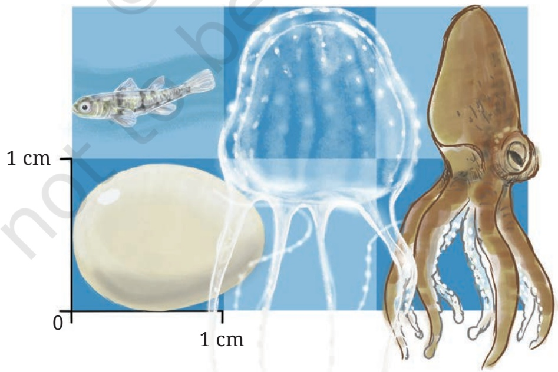

## How many m is (a) 10 cm? (b) 15 cm?

$$
10   cm  = \frac{1}{10}   m  = 0.1   m
$$

Since each cm is one-hundredth of a meter, 15 cm can be written as

$$
15   cm  = \frac{15}{100}   m
$$

$$
\frac{10}{100}    m  + \frac{5}{100}    m
$$

$$
\frac{1}{10}    m  + \frac{5}{100}    m
$$

$$
= 0 . 1 5 \; \mathrm { m } .
$$

Fill in the blanks below (cm <–> m):

| 36 cm = _______ | 50 cm = _______ | _______ = 0.89 m |
| --- | --- | --- |
| 4 cm = _______ | 325 cm = _______ | ________ = 2.07 m |

How many mm does 1 meter have?

Can we write 1 $\mathrm{mm} = \frac{1}{1000} \mathrm{m}?$

Here, we have some more interesting facts about small things in nature!

