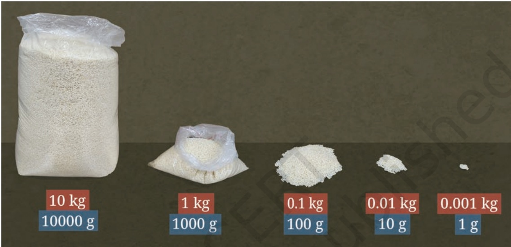

| 465 g = _______ | 68 g = _________ | 1560 g = ________ |
| --- | --- | --- |
| 704 g = _______ | ________ = 0.56 kg | _______ = 2.5 kg |

Look at the picture below showing different quantities of rice. Starting from the 1g heap, subsequent heaps can be found that are 10 times heavier than the previous heap/packets. The combined weight of rice in this picture is 11.111 kg.

Also,

1 gram = 1000 milligrams (mg). So, 1 $mg = \frac{1}{1000}   g  = 0.001   g .$

## Rupee ─ Paise conversion

You may have heard of ‘paisa’. 100 paise is equal to 1 rupee. As we have coins and notes for rupees, coins for paise were also used commonly until recently. There were coins for 1 paisa, 2 paise, 3 paise, 5 paise, 10 paise, 20 paise, 25 paise, and 50 paise. All denominations of 25 paise and less were removed from use in the year 2011. But we still see paise in bills, account statements, etc.

$$
1 { \mathrm { ~ r u p e e } } = 1 0 0 { \mathrm { ~ p a i s e } }
$$

$$
1\  pairs =\frac{1}{100}\  type =0.01\  type .
$$

As each paisa is one-hundredth of a rupee,

$$
75\; pairs = \frac{75}{100}\; type
$$