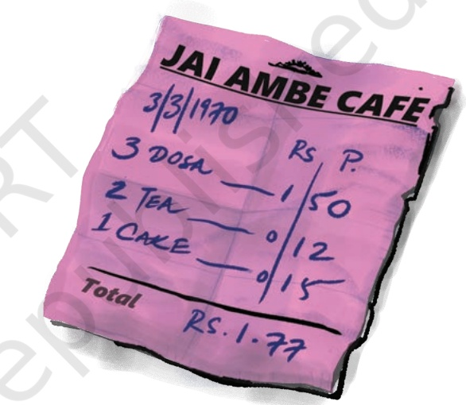
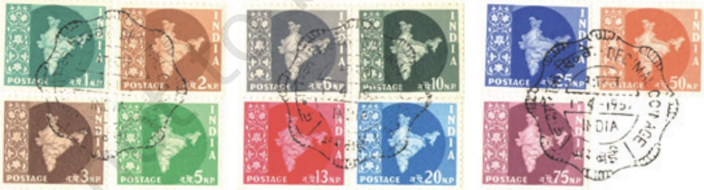

$$
\left( { \frac { 7 0 } { 1 0 0 } } + { \frac { 5 } { 1 0 0 } } \right) { \mathrm { r u p e e } }
$$

$$
\mathbf { = } \left( { \frac { 7 } { 1 0 } } + { \frac { 5 } { 1 0 0 } } \right) \mathbf { r u p e e }
$$

$$
= 0 . 7 5 \; \mathrm { r u p e e } .
$$

Fill in the blanks below (rupee <–> paise)

| 10 p = ___________ | _______p = ₹ 0.05 | ________p = ₹ 0.36 |
| --- | --- | --- |
| _________ = ₹ 0.50 | 99 p = _________ | 250 p = _________ |

During the 1970s, a masala dosa cost just 50 paise, one could buy a banana for 20-25 paise, a handful of peppermints were available for 2 paise or 3 paise, and a kg of rice cost ₹2.45.

Discuss with adults at home/school the prices of different products and services during their childhood. Try to find old coins and stamps.

## 3.6 Locating and Comparing Decimals

Let us consider the decimal number 1.4. It is equal to 1 unit and 4 tenths. This means that the unit between 1 and 2 is divided into 10