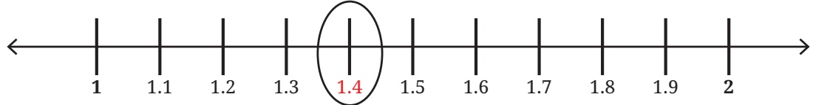
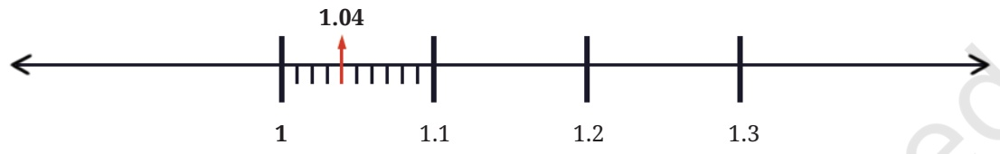
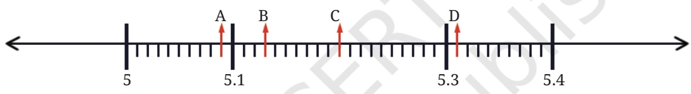

equal parts, and 4 such parts are taken. Hence, 1.4 lies between 1 and 2. Draw the number line and divide the unit between 1 and 2 into 10 equal parts. Take the fourth part, and we have 1.4 on the number line.

? Name all the divisions between 1 and 1.1 on the number line.

? Identify and write the decimal numbers against the letters.

**There is Zero Dilemma!**

Sonu says that 0.2 can also be written as 0.20, 0.200; Zara thinks that putting zeros on the right side may alter the value of the decimal number. What do you think?

We can figure this out by looking at the quantities these numbers represent using place value.

| Decimal number | Units | Tenths | Hundredths | Thousandths |
| --- | --- | --- | --- | --- |
| 0.2 | 0 | 2 |  |  |
| 0.20 | 0 | 2 | 0 |  |
| 0.200 | 0 | 2 | 0 | 0 |
| 0.02 | 0 | 0 | 2 |  |
| 0.002 | 0 | 0 | 0 | 2 |

We can see that 0.2, 0.20, and 0.200 are all equal as they represent the same quantity, i.e., 2 tenths. But 0.2, 0.02, and 0.002 are different.