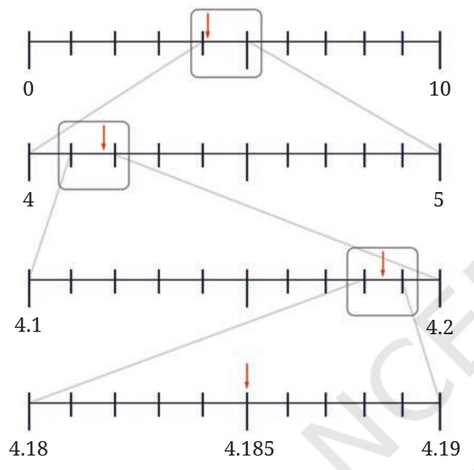
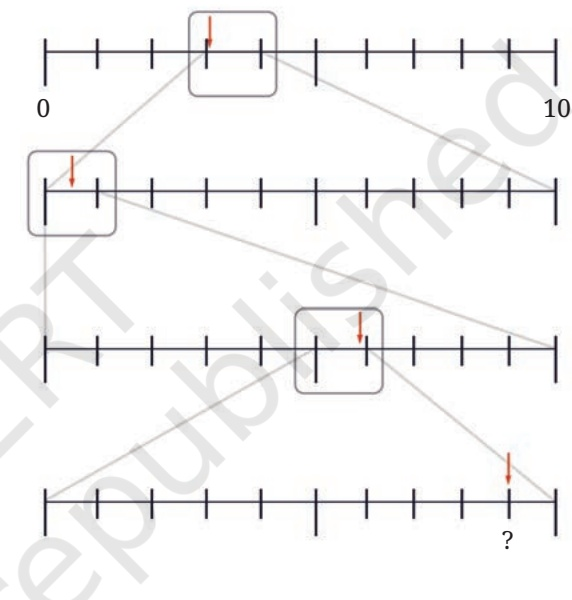
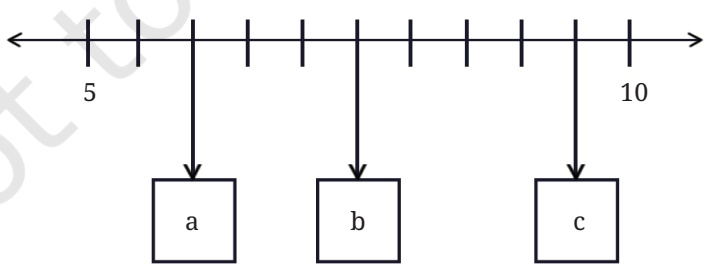

？ Can you tell which of these is the smallest and which is the largest?

? Which of these are the same: 4.5, 4.05, 0.405, 4.050, 4.50, 4.005, 04.50?

Observe the number lines in Figure (a) below. At each level, a particular segment of the number line is magnified to locate the number 4.185.

？ Identify the decimal number in the last number line in Figure (b) denoted by $\sum _ { i } ^ { i }$

(a)

(b)

？ Make such number lines for the decimal numbers: (a) 9.876 (b) 0.407.

？ In the number line shown below, what decimal numbers do the boxes labelled ${ \bf \Phi } ^ { \circ } { \bf a } ^ { \flat }$ , $\text{" } \text{" } \text{" } \text{" }$ , and $^ { \circ } \mathrm { c } ^ { \prime }$ denote?

The box with $\text{" } \text{" } \text{" } \text{" }$ corresponds to the decimal number 7.5; are you able to see how? There are 5 units between 5 and 10, divided into 10 equal parts. Hence, every 2 divisions make a unit, and so every division is $\frac { 1 } { 2 }$ unit. What numbers do ${ \bf \Phi } ^ { \circ } { \bf a } ^ { \prime }$ and $^ { \circ } \mathrm { c } ^ { \prime }$ denote?