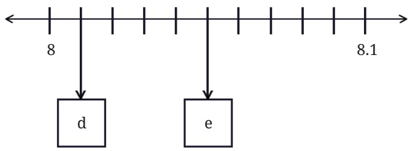
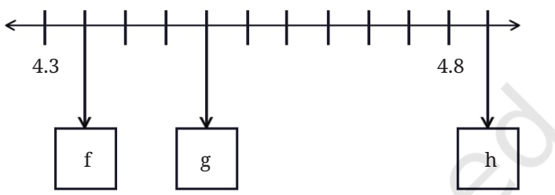
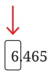
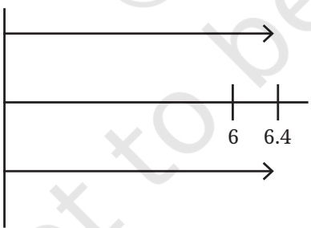
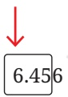
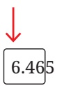

？ Using similar reasoning find out the decimal numbers in the boxes below.

Which is larger: 6.456 or 6.465?

To answer this, we can use the number line to locate both decimal numbers and show which is larger.

This can also be done by comparing the corresponding digits at each place value, as we do with whole numbers.

This comparison is

visualised step by step below. Note that the visualisation below is not to scale.

<table><tr><td rowspan="3">→ 6456 </td><td></td><td>Both numbers have 6 units.</td></tr><tr><td></td><td>Both numbers have 6 units</td></tr><tr><td></td><td>and 4 tenths.</td></tr><tr><td colspan="2"> </td><td colspan="2">Both numbers have 6 units and 4 tenths, but the first number has only 5 hundredths, whereas the second number has 6 hundredths.</td></tr></table>