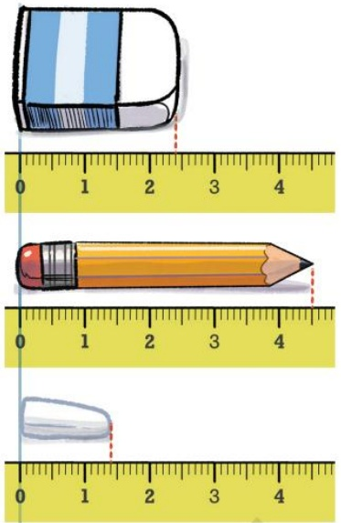

# Chapter – 3 A Peek Beyond the Point

**Page No. 47**

**Write the measurements of the objects shown in the picture.**

**Ans:**

Eraser $\rightarrow   2 { \frac { 4 } { 1 0 } }$ cm, Pencil $\rightarrow   4 { \frac { 5 } { 1 0 } }$ cm $\rightarrow 4 { \frac { 1 } { 2 } }$ cm, Chalk $\rightarrow   1 { \frac { 4 } { 1 0 } } \; c m$

**Page No. 49**

**Arrange the lengths in increasing order: (a)** $\frac { 9 } { 1 0 }$ (b) $\mathbf { 1 } \frac { 7 } { \mathbf { 1 0 } }$ **(c)** $\frac { \mathbf { 1 3 0 } } { \mathbf { 1 0 } }$ (d) $\mathbf { 1 3 } { \frac { 1 } { \mathbf { 1 0 } } }$ (e) $\mathbf { 1 0 } { \frac { 5 } { \mathbf { 1 0 } } }$ (f) $7 \frac { 6 } { 1 0 }$ (g) $\mathbf { 6 } \frac { 7 } { 1 0 }$ **(h)** $\frac { 4 } { 1 0 }$

**Ans:**

$$
\frac{4}{10}, \frac{9}{10}, \frac{7}{10}, \frac{6}{10}, \frac{7}{10}, \frac{6}{10}, \frac{10}{10}, \frac{130}{10}, \frac{1}{10}
$$