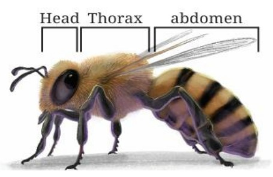

## Page No. 50

**Arrange the following lengths in increasing order:** $4 { \frac { 1 } { 1 0 } }$ $^ { \frac { 4 } { 1 0 } } , ^ { \frac { 4 1 } { 1 0 } } , ^ { 4 1 } { \textstyle \frac { 1 } { 1 0 } }$

**Ans:**

Increasing order: $\frac{4}{10}, \frac{41}{10} = 4\frac{1}{10}, 41\frac{1}{10}$

**Page No. 51**

**The lengths of the body parts of a honeybee are given. Find its total length.**

<table><tr><td></td><td> $\boxed { \mathrm { H e a d } \; = \; 2 \frac { 3 } { 1 0 } \; \mathrm { u n i t s } }$   $\mathrm { T h o r a x } \; = \; 5 \frac { 4 } { 1 0 } \; \mathrm { u n i t s }$ </td></tr></table>

**Ans:** $1 5   \frac { 2 } { 1 0 }$ units.

**Page No. 52**

**A Celestial Pearl Danio’s length is** $2 \frac { 4 } { 1 0 }$ **cm, and the length of a Philippine Goby is** $\frac { 9 } { 1 0 }$ **cm. What is the difference in their lengths? Ans:** 1 $\frac { 5 } { 1 0 }$ cm

？ **Observe the given sequences of numbers. Identify the change after each term and extend the pattern:**

(a) $4,4\frac{3}{10},4\frac{6}{10}$

(b) $8 \frac{2}{10}, 8 \frac{7}{10}, 9 \frac{2}{10},$

**(c)** $7 \frac{6}{10}, 8 \frac{7}{10},$