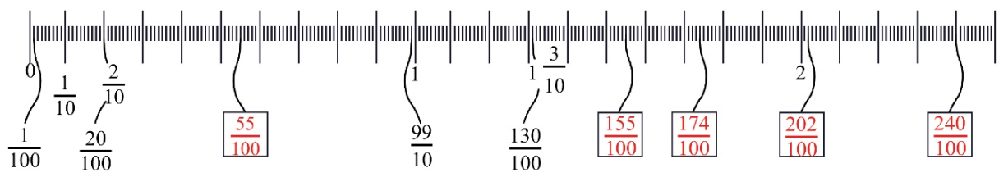
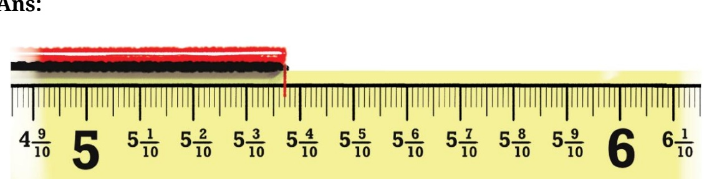
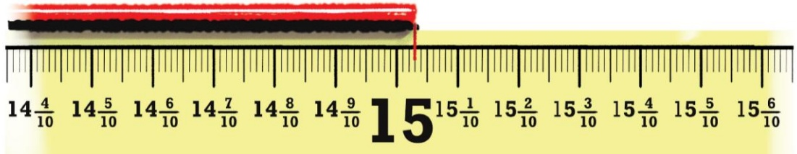

？ **Observe the figure below. Notice the markings and the corresponding lengths written in the boxes when measured from 0. Fill the lengths in the empty boxes.**

**For the lengths shown below write the measurements and read out the measures in words.**

Measurement $- 5 { \frac { 3 7 } { 1 0 0 } }$

In words: Five and thirtyseven-hundredths.

Measurement − $1 5 { \frac { 3 } { 1 0 0 } }$

In words: Fifteen and three-hundredths.