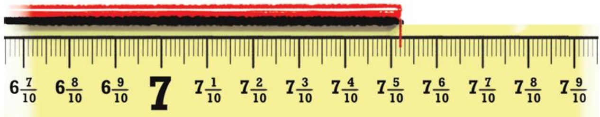
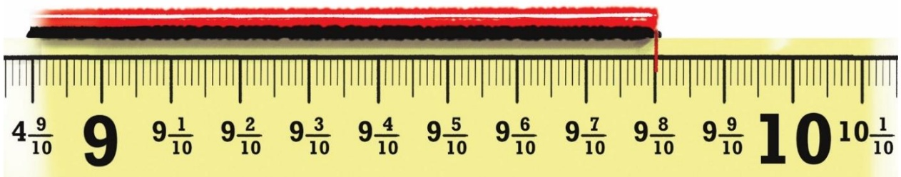
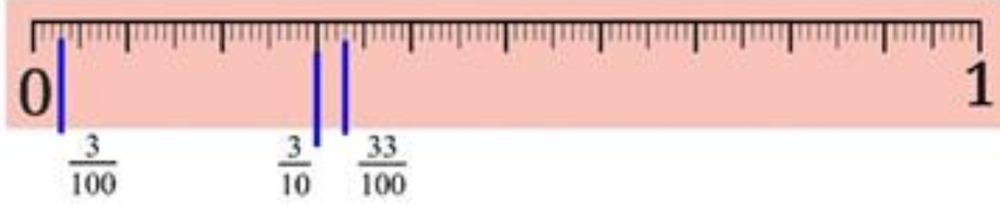

$$
\mathrm { M e a s u r e m e n t } - 7 { \frac { 5 2 } { 1 0 0 } }
$$

Page No. 55

In words: Seven and fiftytwo-hundredths.

Measurement − $9 { \frac { 8 0 } { 1 0 0 } }$

In words: Nine and eighty-hundredths.

？ **In each group, identify the longest and the shortest lengths. Mark each length on the scale.**

**Ans:**

$\frac{3}{10}, \frac{3}{100}, \frac{33}{100}$

