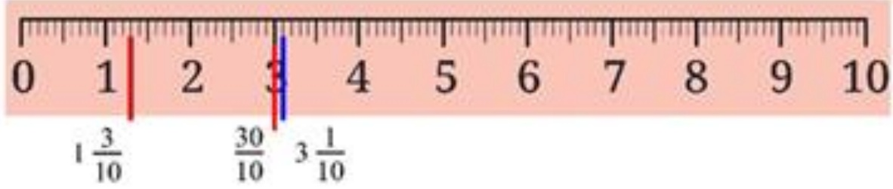
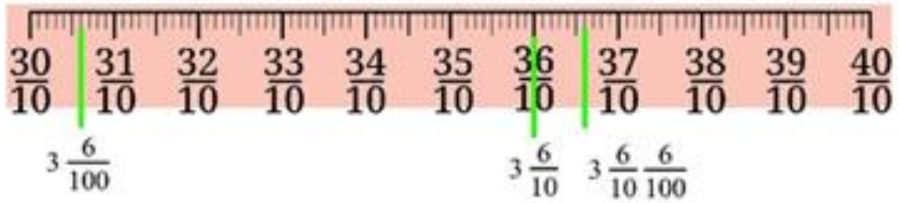

$3 \frac{1}{10}, \frac{30}{10}, 1 \frac{3}{10}$

$\frac{45}{100}, \frac{54}{100}, \frac{5}{10}, \frac{4}{10}$

$3\frac{6}{10}, 3\frac{6}{100}, 3\frac{6}{10}\frac{6}{100}$

(a) $\mathrm { L o n g e s t } = { \frac { 3 3 } { 1 0 0 } }$

3 Shortest = 100

(b) $\mathrm { L o n g e s t } = 3   { \frac { 1 } { 1 0 } }$

$$
{ \mathrm { S h o r t e s t } } = 1 { \frac { 3 } { 1 0 } }
$$

(c) $\mathrm { L o n g e s t } = { \frac { 5 4 } { 1 0 0 } }$

$$
{ \mathrm { S h o r t e s t } } = { \frac { 4 } { 1 0 } }
$$

(d) $\mathrm { L o n g e s t } = 3   { \frac { 6 } { 1 0 } }   { \frac { 6 } { 1 0 0 } }$

6 Shortest = 3 100