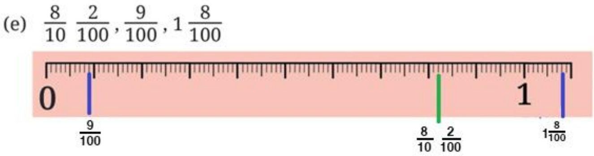
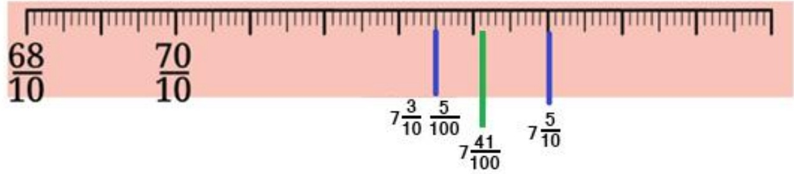
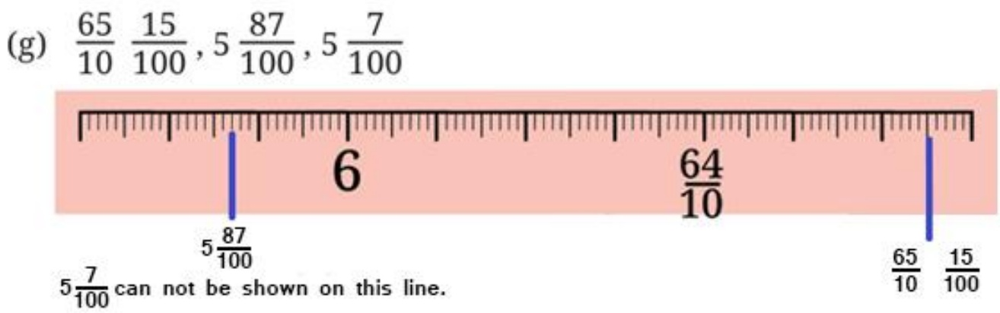

(f) $7\frac{3}{10}\frac{5}{100}, 7\frac{5}{10}, 7\frac{41}{100}$

$\frac{65}{10} \frac{15}{100}, 5 \frac{87}{100}, 5 \frac{7}{100}$

(e) $\mathrm { L o n g e s t } = 1 \frac { 8 } { 1 0 0 }$

9 Shortest = 100

(f) $\mathrm { L o n g e s t } = 7 { \frac { 5 } { 1 0 0 } }$

Sh $\mathrm{rot} = 7 \frac{3}{10} \frac{5}{100}$

(g) $\mathrm{Logest}=\frac{65}{10}\frac{15}{100}$

7 Shortest = 5 100