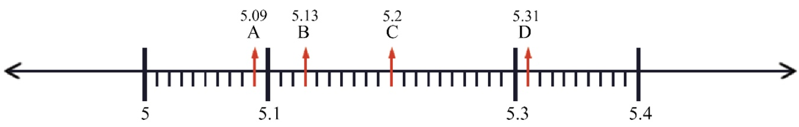

## Page No. 69

？ **Fill in the blanks below (rupee < – > paise)**

| 10 p = ₹0.10 | 5 p = ₹0.05 | 36 p = ₹0.36 |
| --- | --- | --- |
| 50 p= ₹0.50 | 99 p = ₹0.99 | 250 p = ₹2.50 |

**Page No. 70**

? **Name all the divisions between 1 and 1.1 on the number line.**

**Ans:** The small divisions between 1 and 1.1 on the number line (if the subdivision is of 10 parts) are: 1.01, 1.02, 1.03, 1.04, 1.05, 1.06, 1.07, 1.08, 1.09

？ **Identify and write the decimal numbers against the letters.**

**Ans:**

**Page No. 71**

？ **Can you tell which of these is the smallest and which is the largest?**

**Ans:**

| DecimalNumber | Units | Tenths | Hundredths | Thousandths |
| --- | --- | --- | --- | --- |
| 0.2 | 0 | 2 | 0 | 0 |
| 0.20 | 0 | 2 | 0 | 0 |
| 0.200 | 0 | 2 | 0 | 0 |
| 0.02 | 0 | 0 | 2 | 0 |
| 0.002 | 0 | 0 | 0 | 2 |

0.2 = 0.20 = 0.200 is the largest.