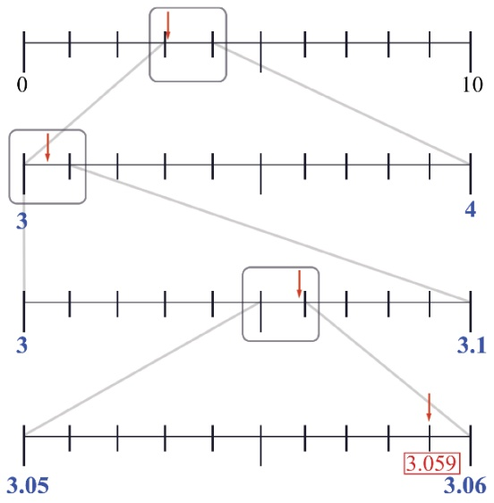
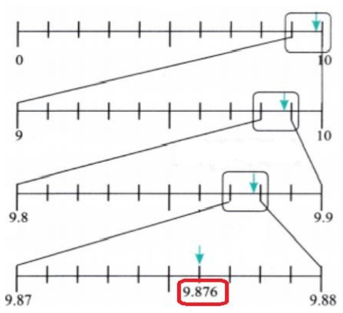
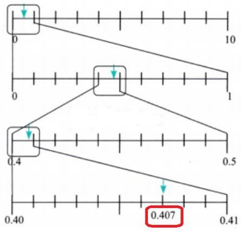

0.002 is the smallest.

**Which of these are the same: 4.5, 4.05, 0.405, 4.050, 4.50, 4.005, 04.50? Ans:** 4.5, 4.50, and 04.50 are equal. 4.05 and 4.050 are equal.

**Identify the decimal number in the last number line in Figure (b) denoted by ‘?’**

**Ans:**

(b)

**Make such number lines for the decimal numbers: (a) 9.876 (b) 0.407. Ans: (a) (b)**

