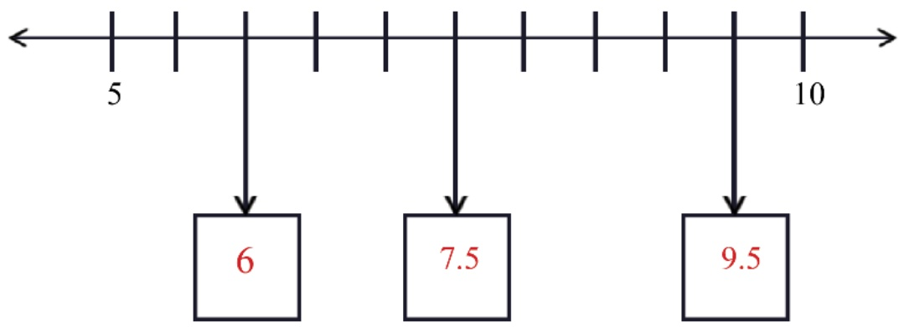
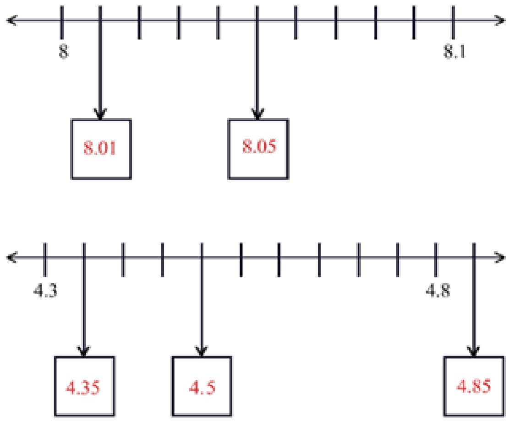

？ **In the number line shown below, what decimal numbers do the boxes labelled ‘a’, ‘b’, and ‘c’ denote?**

**Ans:**

Page No. 72

？ **Using similar reasoning find out the decimal numbers in the boxes below.**

**Ans:**

