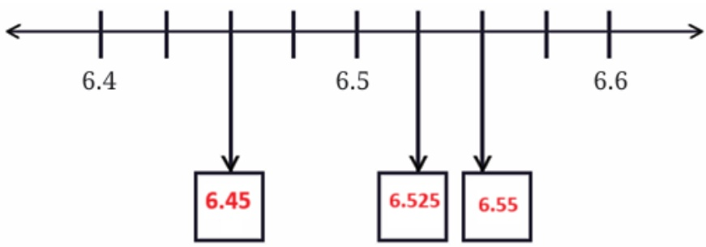

**4. Arrange the following quantities in descending order: (a) 11.01, 1.011, 1.101, 11.10, 1.01** → Descending order: 11.10, 11.01, 1.101, 1.011, 1.01.

**(b) 2.567, 2.675, 2.768, 2.499, 2.698** → Descending order: 2.768, 2.698, 2.675, 2.567, 2.499.

**(c) 4.678 g, 4.595 g, 4.600 g, 4.656 g, 4.666 g** →Descending order: 4.678, 4.666, 4.656, 4.600, 4.595.

**(d) 33.13 m, 33.31 m, 33.133 m, 33.331 m, 33.313 m** → Descending order: 33.331, 33.313, 33.31, 33.133, 33.13.

**5. Using the digits 1, 4, 0, 8, and 6 make: (a) the decimal number closest to 30 (b) the smallest possible decimal number between 100 and 1000.**

**Ans:** Using the digits 1, 4, 0, 8, and 6, we can make: (a) 40.168 (b) 104.68

**6. Will a decimal number with more digits be greater than a decimal number with fewer digits?**

**Ans:** No. It is not necessary. For example, 2.05 (2 digits after decimal) vs 2.5 (1 digit after decimal). 2.5 >2.05

**7. Mahi purchases 0.25 kg of beans, 0.3 kg of carrots, 0.5 kg of potatoes, 0.2 kg of capsicums, and 0.05 kg of ginger. Calculate the total weight of the items she bought.**

**Ans:** 1.3 kg

**8. Pinto supplies 3.79 L, 4.2 L, and 4.25 L of milk to a milk dairy in the first three days. In 6 days, he supplies 25 liters of milk. Find the total quantity of milk supplied to the dairy in the last three days.**