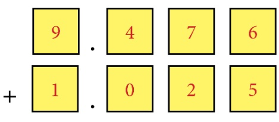

**15. Using each digit 0 – 9 not more than once, fill the boxes below so that the sum is closest to 10.5: Ans:**

**16. Write the following fractions in decimal form: (a)** $\frac { 1 } { 2 }$ **(b)** $\frac { 3 } { 2 }$ **(c)** $\frac { 1 } { 4 }$ **(d)** $\frac{3}{4}$ **(e)** $\frac{1}{5}$ **(f)** $\frac{4}{5}$

**Ans:** (a) 0.5 (b) 1.5 (c) 0.25 (d) 0.75 (e) 0.2 (f) 0.8