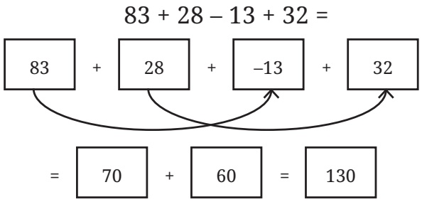
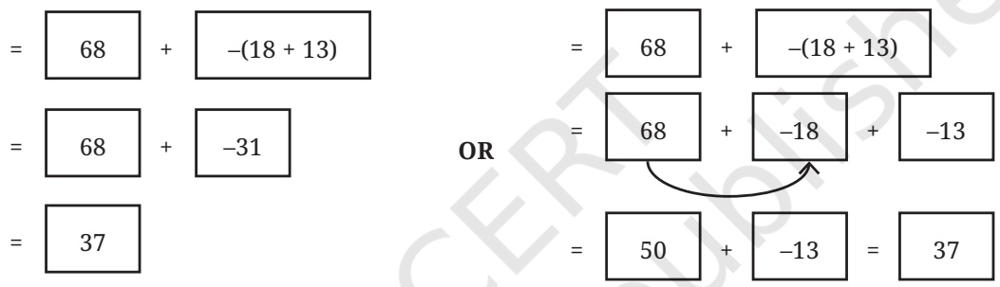

Let us now evaluate the second one. All the terms of this expression are numbers. If we notice the terms, we find that it will be easier to evaluate if we swap and group the terms.

Let us now look at the fifth expression. It has brackets with a negative sign outside. This can be evaluated in two ways — by solving the bracket first (like the solution on the left side) or by removing the brackets appropriately (as on the right side).

Now, find the values of the other arithmetic expressions.

Algebraic expressions also take number values when the letternumbers they contain are replaced by numbers. In Example 1, for finding Shabnam’s age when Aftab is 23 years old, we replaced the letter-number a in the expression a + 3 by 23, and it took the value 26.

## 4.3 Omission of the Multiplication Symbol in Algebraic Expressions

Look at this number sequence:

4, 8, 12, 16, 20, 24, 28, ...

How can we describe this sequence or pattern? Easy: These are the numbers appearing in the multiplication table of 4 (multiples of 4 in an increasing order).

What is the third term of this sequence? It is 4 × 3.

What is the 29th term of this sequence? It is 4 × 29.

？ Find an algebraic expression to get the nth term of this sequence.

Note that here ‘n’ is a letter-number that denotes a position in the sequence.