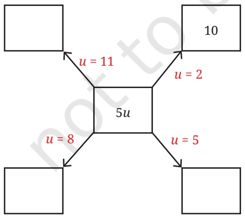
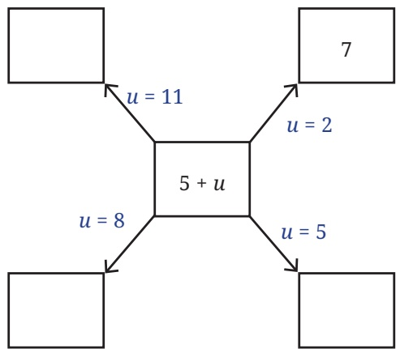

？ Give some possible scores for Krishita in the three rounds so that they add up to give $2 3 p - 7 q .$

## ？ Can we say who scored more? Can you explain why?

How much more has Krishita scored than Charu? This can be found by finding the difference between the two scores. $2 3 p - 7 q - ( 2 1 p - 9 q )$

Simplify this expression further.

**Example 9:** Simplify the expression $4 \left( x + y \right) - y$

Using the distributive property, this expression can be simplified to

$$
\begin{aligned}4\left(x+y\right)&-y=4x+4y-y\\&=4x+4y+-y\\&=4x+(4-1)y\\&=4x+3y.\end{aligned}
$$

**Example 10:** Are the expressions 5u and $5 + u$ equal to each other? The expression 5u means 5 times the number $u ,$ and the expression $5 ~ + ~ u$ means 5 more than the number u. These two being different operations, they should give different values for most values of u.

Let us check this.

？ Fill the blanks below by replacing the letter-numbers by numbers; an example is shown. Then compare the values that 5u and $5 + u$ take.

If the expressions 5u and $5 \mathrm { ~ + ~ } u$ are equal, then they should take the