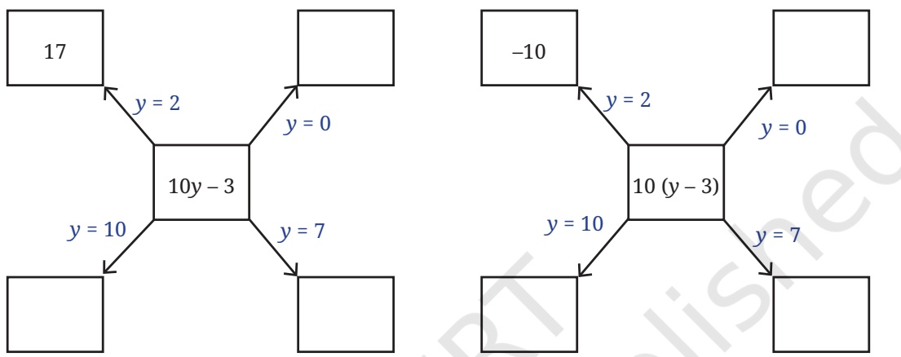
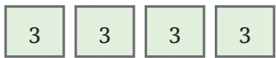
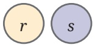
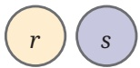
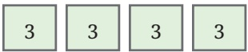

same values for any given value of u. But we can see that they do not. So, these two expressions are not equal.

Are the expressions 10y – 3 and 10(y – 3) equal?

10y – 3, short for 10 × y – 3, means 3 less than 10 times y,

10(y – 3), short for 10 × (y – 3), means 10 times (3 less than y).

Let us compare the values that these expressions take for different values of y.

equal?

**Example 11:** What is the sum of the numbers in the picture (unknown values are denoted by letter-numbers)?

There are many ways to go about it. Here, we show some of them.

1. Adding row wise gives:

$$
(4 \times 3) + (r + s) + (r + s) + (4 \times 3)
$$

2. Adding like terms together gives:

$$
( 8 \times 3 ) + ( r + r ) + ( s + s )
$$

3. Adding the upper half and doubling gives:

$$
2 \times ( 4 \times 3 + r + s )
$$

The three expressions might seem different. We can simplify each one and see that they all are the same: 2r + 2s + 24.

## Figure it Out

1. Add the numbers in each picture below. Write their corresponding expressions and simplify them. Try adding the numbers in each picture in a couple different ways and see