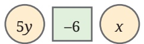
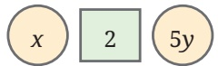
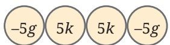
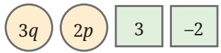
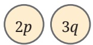
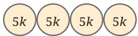
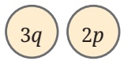
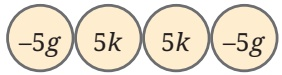

that you get the same thing.

2. Simplify each of the following expressions:

(a) $p + p + p + p , p + p + p + q ,$ (b) p + q + p – q,

(c) p – q + p – q, (d) p + q – p + q,

(e) p + q – (p + q), (f) p – q – p – q

(g) 2d – d – d – d, (h) 2d – d – d – c,

(i) 2d – d – (d – c), (j) $2d - (d - d) = c,$

(k) $2 d - d - c - c$

## Mind the Mistake, Mend the Mistake

Some simplifications of algebraic expressions are done below. The expression on the right-hand side should be in its simplest form.

• Observe each of them and see if there is a mistake.

If you think there is a mistake, try to explain what might have gone wrong.

• Then, simplify it correctly.

**Expression**

**Simplest Form**

**Correct Simplest Form**

$$
1. $3 a + 2 b$
$$

$$
2. $3 b - 2 b - b$
$$

$$
3. 6 (p + 2)
$$

$$
6 p + 8
$$

$$
4.\quad (4x + 3y) - (3x + 4y)
$$

$$
x + y
$$

$$
5 - 5 - (2 - 6z)
$$

$$
3 - 6 z
$$

$$
2+(x+3)
$$

$$
2 x - 6
$$

$$
7. 2y+(3y-6)
$$

$$
- y + 6
$$

8. $7 p - p + 5 q - 2 q$ 7p + 3q

9. $5 \left( 2w + 3x + 4w \right)$ 10w + 15x + 20w