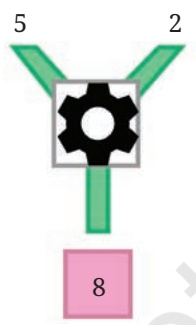
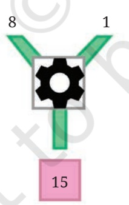
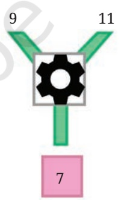
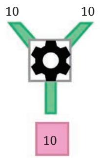
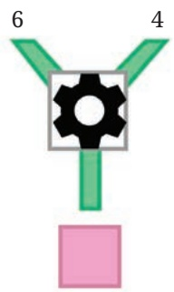

$$
10.\quad 3j+6k+9h+12
$$

$$
3 \left( j + 2 k + 3 h + 4 \right)
$$

11.  4 $( 2 r + 3 s + 5 )$

$$
- 2 0 - 8 r - 1 2 s
$$

? Take a look at all the corrected simplest forms (i.e. brackets are removed, like terms are added, and terms with only numbers are also added). Is there any relation between the number of terms and the number of letter-numbers these expressions have?

## 4.5 Pick Patterns and Reveal Relationships

In the first section we got a glimpse of algebraic expressions and how to use them to describe simple patterns and relationships in a concise and elegant manner. Here, we continue to look for general relationships between quantities in different scenarios, find patterns and, interestingly, even explain why these patterns occur.

Remember the importance of describing in simple language, or visualising mathematical relationships, before trying to write them as expressions.

## Formula Detective

Look at the picture given. In each case, the number machine takes in the 2 numbers at the top of the ‘Y’ as inputs, performs some operations and produces the result at the bottom. The machine performs the same operations on its inputs in each case.

Find out the formula of this number machine.

expression:

expression:

expression:

expression:

expression:

The formula for the number machine above is “two times the first number minus the second number”. When written as an algebraic expression, the formula is $2 a - b .$ The expression for the first set of inputs is $2 \times 5 - 2 = 8$ . Check that the formula holds true for each set of inputs.