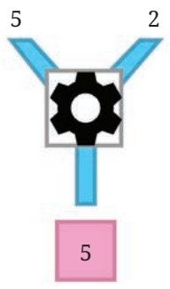
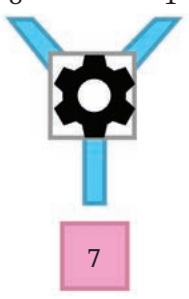
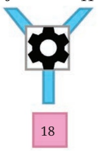
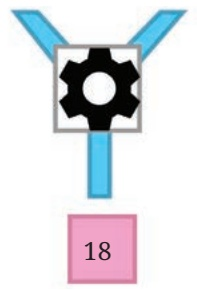
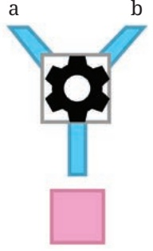
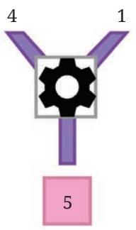
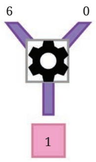
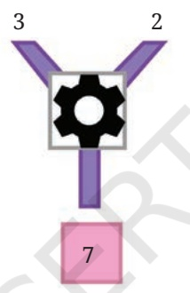
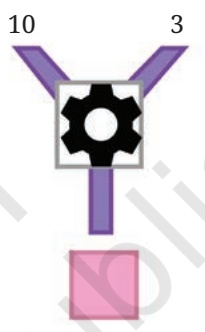
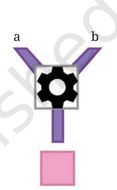

？ Find the formulas of the number machines below and write the expression for each set of inputs.

expression:

expression:

expression:

expression:

8

1

9

11

10

10

a

b

expression:

expression:

expression:

expression:

10

expression:

expression:

? Now, make a formula on your own. Write a few number machines as examples using that formula. Challenge your classmates to figure it out!

**Note to the Teacher:** Not just solving problems but creating new questions is also very much a part of learning and doing mathematics!

## Algebraic Expressions to Describe Patterns

？ **Example 12:** Somjit noticed a repeating pattern along the border of a saree.

A

B

C

D

E

F

? Somjit wonders if there is a way to describe all the positions where the (i) Design A occurs, (ii) Design B occurs, and (iii) Design C occurs.