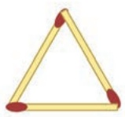
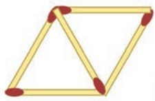
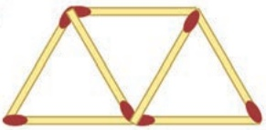
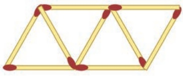

## Matchstick Patterns

Look at the picture below. It is a pattern using matchsticks. Can you identify what the pattern is?

3

2

We can see that Step 1 has 1 triangle, Step 2 has 2 triangles, Step 3 has 3 triangles, and so on.

Step 5? It is 11. You can also draw this and see.

? How many matchsticks will there be in Step 33, Step 84, and Step 108? Of course, we can draw and count, but is there a quicker way to find the answers using the pattern present here?

What is the general rule to find the number of matchsticks in the next step? We can see that at each step 2 matchsticks are placed to get the next one, i.e., the number of matchsticks increases by 2 every time.

| Step Number | 1 | 2 | 3 | 4 | 5 | 6 |
| --- | --- | --- | --- | --- | --- | --- |
| No. of Matchsticks | 3 | 5 | 7 | 9 | 11 | 13 |

Think of a way to use this to find out the number of matchsticks in Step 33 (without continuing to write the numbers).

As each time 2 matchsticks are being added, finding out how many 2s will be added in Step 33 will help. Look at the table below and try to find out.

| Step Number | 1 | 2 | 3 | 4 | 5 | 6 |
| --- | --- | --- | --- | --- | --- | --- |
| No. of Matchsticks | 3 | 5 | 7 | 9 | 11 | 13 |
|  |  | 3 + 2 | 3 + 2 + 2 | 3 + 2 + 2 + 2 | 3 + 2 + 2 + 2 + 2 |  |

The number of matchsticks needed to make 33 triangles (Step 33) is. Similarly, find the number of matchsticks needed for Step 84 and Step 108.