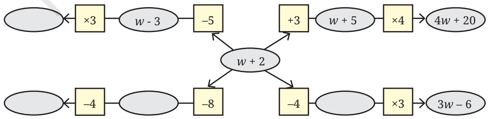

## Figure it Out

For the problems asking you to find suitable expression(s), first try to understand the relationship between the different quantities in the situation described. If required, assume some values for the unknowns and try to find the relationship.

1. One plate of Jowar roti costs ₹30 and one plate of Pulao costs ₹20. If x plates of Jowar roti and y plates of pulao were ordered in a day, which expression(s) describe the total amount in rupees earned that day? (a) $3 0 x \pm 2 0 y$ (b) $( 3 0 + 2 0 ) \times ( x + y )$ (c) $2 0 x \pm 3 0 y$ (d) $(30 + 20) \times x + y$ (e) $3 0 x - 2 0 y$

2. Pushpita sells two types of flowers on Independence day: champak and marigold. ${ } ^ { \circ } p ^ { \prime }$ customers only bought champak, $^ { \circ } q ^ { \prime }$ customers only bought marigold, and $\boldsymbol { ^ { \circ } r ^ { \circ } }$ customers bought both. On the same day, she gave away a tiny national flag to every customer. How many flags did she give away that day? (a) $p + q + r$ (b) $p + q + 2 r$ (c) $2 \times ( p + q + r )$ (d) $p + q + \underline{r} + 2$ (e) $p + q + r + 1$ (f) $2 \times (p + q)$

3. A snail is trying to climb along the wall of a deep well. During the day it climbs up ${ } ^ { \circ } u ^ { \flat }$ cm and during the night it slowly slips down $^ { \circ } d$ cm. This happens for 10 days and 10 nights.

(a) Write an expression describing how far away the snail is from its starting position.

(b) What can we say about the snail’s movement if $d \geq u ?$

4. Radha is preparing for a cycling race and practices daily. The first week she cycles 5 km every day. Every week she increases the daily distance cycled by ${ } ^ { \circ } Z ^ { \prime }$ km. How many kilometers would Radha have cycled after 3 weeks?

5. In the following figure, observe how the expression $w + 2$ becomes 4w + 20 along one path. Fill in the missing blanks on the remaining paths. The ovals contain expressions and the boxes contain operations.

